# 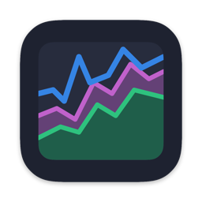 iRessources

[English](README.md) · **Français**

Portage natif macOS de [Resources](https://github.com/nokyan/resources), le moniteur système de GNOME, écrit en Swift / SwiftUI et s'appuyant directement sur les API de Darwin (Mach, IOKit, IOReport, libproc, SystemConfiguration, CoreWLAN).

<picture>
  <source media="(prefers-color-scheme: dark)" srcset="docs/screenshots/cpu-dark.png">
  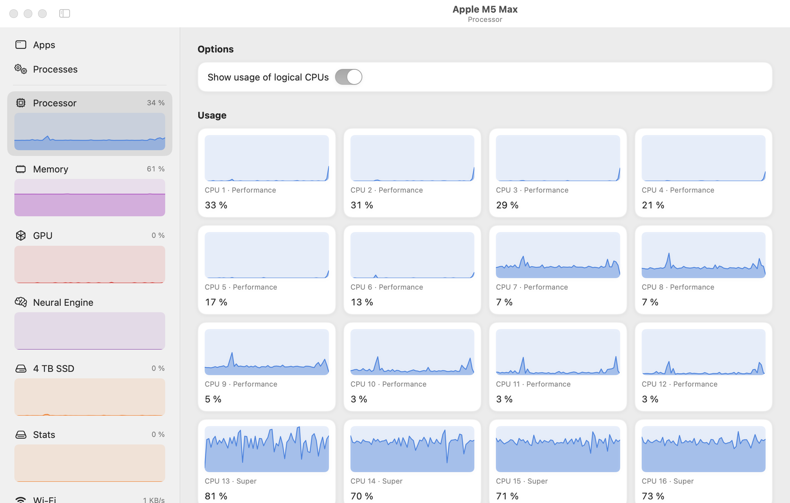
</picture>

L'interface reprend l'esprit de Resources : barre latérale avec un graphe par périphérique, pages « Usage » / « Properties » en listes encadrées, tableaux Apps et Processus avec barre d'action en bas.

| | |
| --- | --- |
| <picture><source media="(prefers-color-scheme: dark)" srcset="docs/screenshots/drive-dark.png">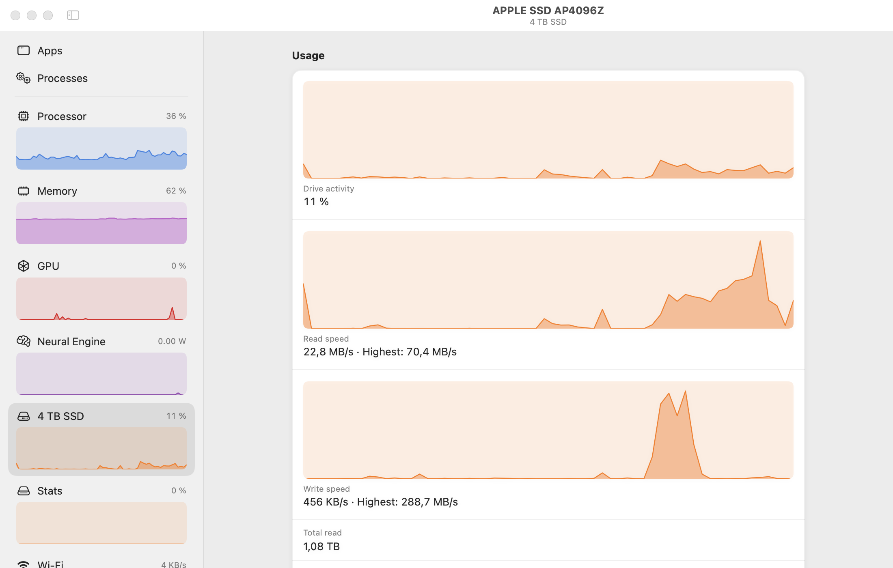</picture> | <picture><source media="(prefers-color-scheme: dark)" srcset="docs/screenshots/memory-dark.png">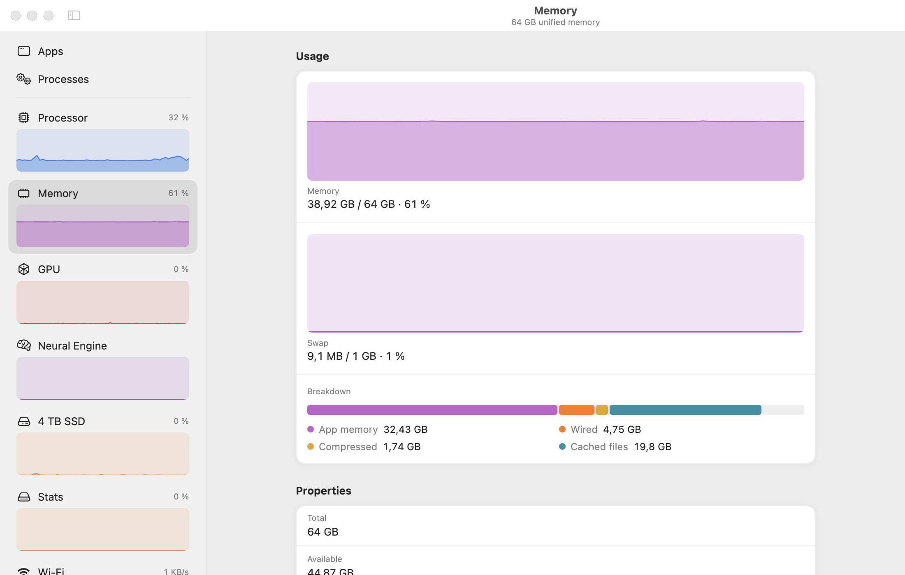</picture> |
| <picture><source media="(prefers-color-scheme: dark)" srcset="docs/screenshots/gpu-dark.png">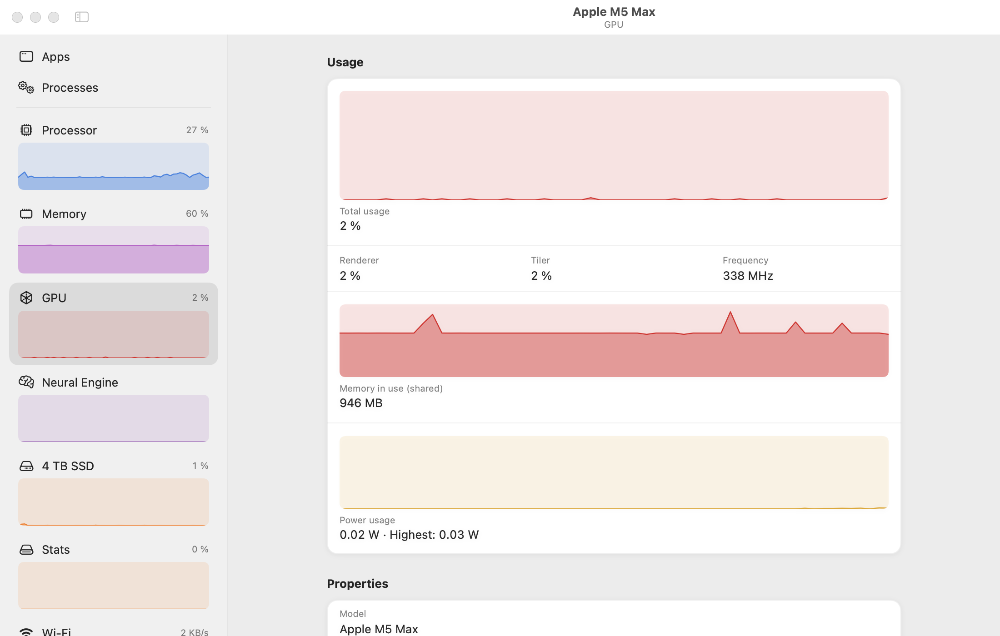</picture> | <picture><source media="(prefers-color-scheme: dark)" srcset="docs/screenshots/battery-dark.png">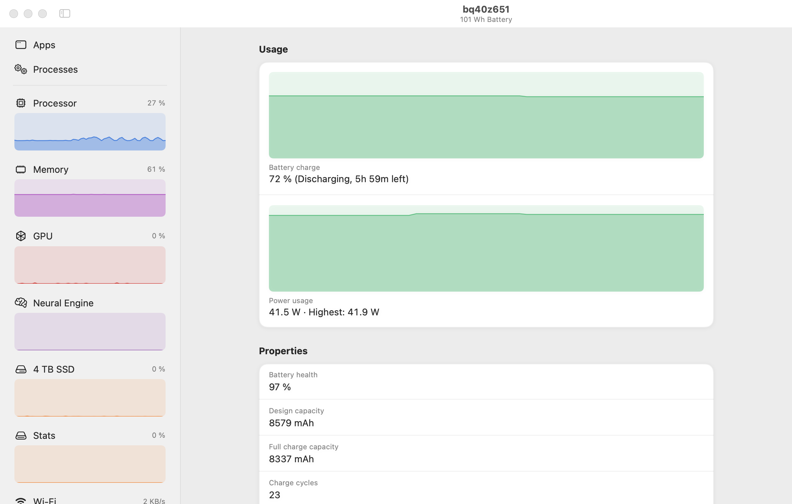</picture> |

Les captures suivent le thème clair ou sombre de votre compte GitHub.

## Remerciements

iRessources n'existerait pas sans **[Resources](https://github.com/nokyan/resources)**, l'excellent moniteur système pour GNOME créé par **[nokyan](https://github.com/nokyan)**. Le design, l'organisation des pages et une bonne partie des idées viennent de là. Un grand merci à son auteur, qui a accepté avec beaucoup de gentillesse que son travail serve de base à ce portage.

Si vous êtes sous Linux, c'est Resources qu'il vous faut : [sur Flathub](https://flathub.org/apps/net.nokyan.Resources) ou [sur GitHub](https://github.com/nokyan/resources).

## D'une app GNOME à une app macOS

iRessources est une réécriture, pas une recompilation : Resources est écrit en Rust avec GTK 4 / libadwaita et lit `/proc`, `/sys` et les pilotes Linux, rien de tout cela n'existe sur macOS. Chaque collecteur a donc été réécrit sur les interfaces de Darwin, et l'interface refaite en SwiftUI.

Ce qui a été **transposé** :

- Les sources de données : `/proc` → Mach et `libproc` ; hwmon → capteurs HID ; RAPL, sysfs et NVML → IOReport et `IOAccelerator` ; `/sys/block` → `IOBlockStorageDriver` ; `/sys/class/net` → `SystemConfiguration` et CoreWLAN ; `/sys/class/power_supply` → `AppleSmartBattery`.
- Les « apps » : là où Resources s'appuie sur les cgroups et les fichiers `.desktop`, iRessources regroupe les processus par « processus responsable » (comme le Moniteur d'activité), ce qui rattache aussi les helpers XPC à leur application.
- Les spécificités d'Apple silicon : types de cœurs (Super / Performance / Efficacité), fréquence par cluster, Neural Engine, mémoire unifiée.

Ce qui a été **ajouté ou adapté** :

- Tiroir de détails sous la liste des apps, avec réglage de la priorité (*nice*) et un **mode arrière-plan** qui cantonne l'app aux cœurs les plus économes et ralentit ses E/S.
- Thèmes (dont *Adwaita*, qui reprend les couleurs de Resources), animations désactivables, raccourcis clavier macOS.
- Une attention particulière à la sobriété : collecte à la demande selon la page affichée, ralentissement quand la fenêtre est masquée (voir [Sobriété](#sobriété)).

## Gardez la main sur vos apps

Sélectionnez une app pour ouvrir un tiroir sous la liste : son emplacement sur le disque, ce qu'elle consomme en ce moment, un **curseur de priorité (*nice*)** appliqué à tous ses processus et un **mode arrière-plan** qui la cantonne aux cœurs les plus économes et ralentit ses accès disque et réseau. Pratique pour une longue compilation ou un export qui ne doit pas ralentir tout le reste.

Le bouton **Pause** (orange) de la barre d'action suspend tous les processus des apps sélectionnées : elles n'utilisent plus le processeur jusqu'à ce que vous cliquiez sur **Resume** (vert). Une app en pause affiche ⏸ à côté de son nom. Pratique pour libérer la machine un moment sans perdre l'état d'une app.

<picture><source media="(prefers-color-scheme: dark)" srcset="docs/screenshots/apps-dark.png">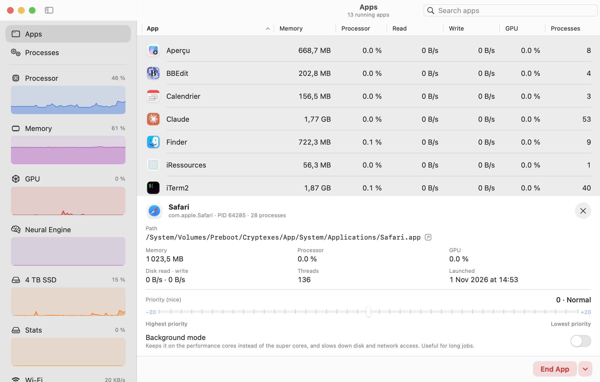</picture>

## Fonctionnalités

| Page | Contenu |
| --- | --- |
| **Apps** | Applications ouvertes, regroupant tous leurs processus (y compris les helpers XPC, via le « processus responsable » comme dans le Moniteur d'activité). Mémoire, processeur, lecture/écriture disque, GPU. Quitter, forcer à quitter, masquer, mettre en pause et reprendre ; priorité et mode arrière-plan. |
| **Processes** | Tous les processus : PID, utilisateur, mémoire (empreinte physique), processeur, threads, E/S disque, GPU par processus. Terminer, tuer, suspendre, reprendre ; panneau de détails (ligne de commande, parent, temps CPU…). |
| **Processor** | Usage total et par cœur logique, type de cœur (Super/Performance/Efficacité), fréquence et activité par cluster, puissance (si exposée), cache, charge, température SoC, état thermique. |
| **Memory** | Utilisée / totale, swap, répartition (apps, câblée, compressée, cache), pression mémoire. |
| **GPU** | Usage (renderer/tiler), mémoire, fréquence et puissance (Apple silicon), nombre de cœurs. |
| **Neural Engine** | Puissance consommée par l'ANE (macOS ne publie pas de pourcentage d'utilisation). |
| **Drives** | Activité, débits lecture/écriture, volumes montés, interface, température NAND. |
| **Network** | Débits reçus/envoyés, adresses, Wi-Fi (signal, canal, norme, débit du lien). |
| **Battery** | Charge, puissance, santé, cycles, capacités, tension, température, adaptateur secteur. |

Quand la fenêtre est masquée, l'app rafraîchit au plus toutes les 5 s et coupe les collecteurs coûteux.

## Thèmes et animations

*Réglages › Appearance* propose les thèmes **Adwaita** (couleurs de Resources), **macOS**, **Pastel**, **Nord**, **Dracula**, **Solarized** et **Graphite**, ainsi que le mode clair, sombre ou automatique.

| Adwaita | Dracula | Nord |
| --- | --- | --- |
| 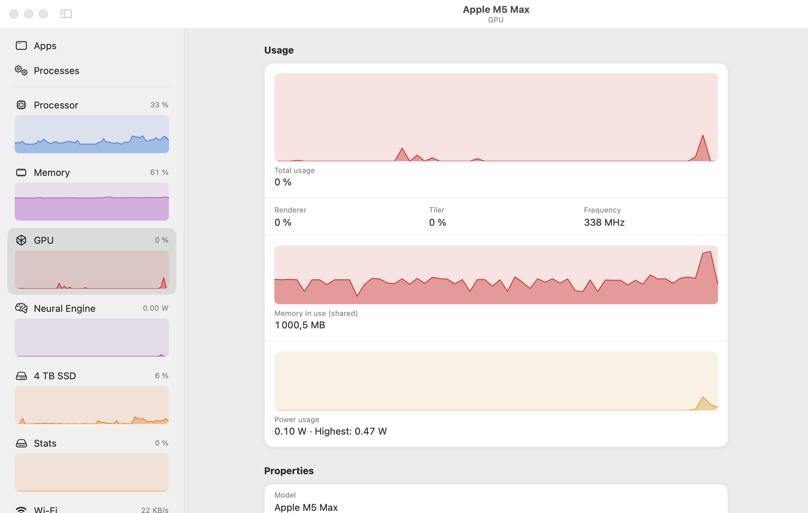 | 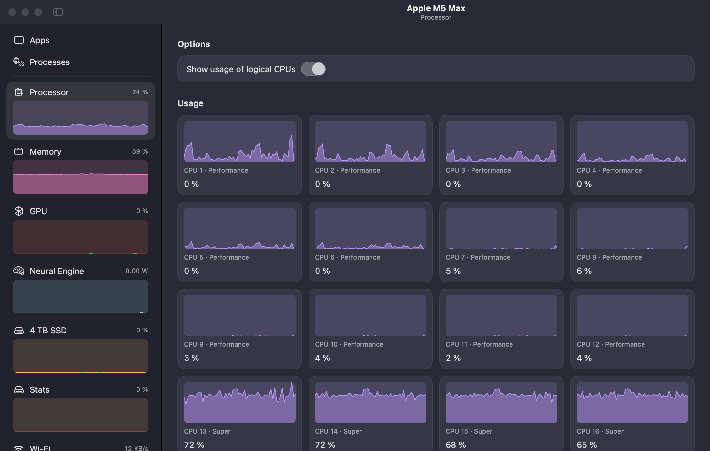 | 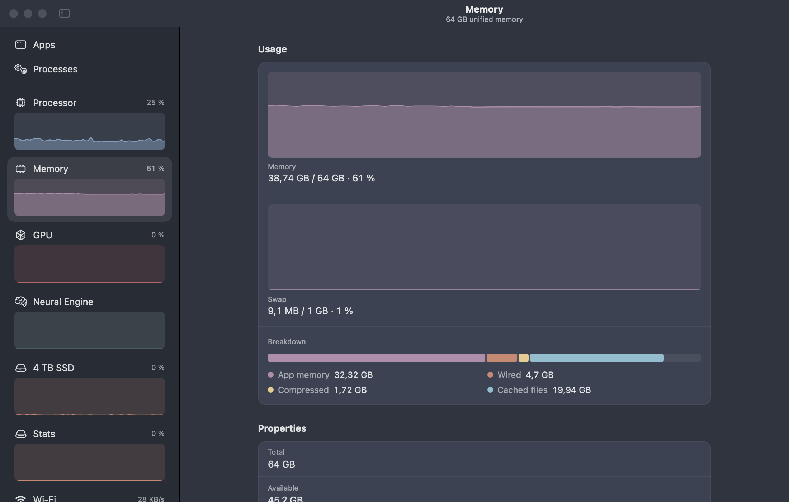 |

L'icône de l'app se choisit aussi : **Pulse** (par défaut), **Gauge**, **Chip** ou **Bars**, inspirées du Moniteur d'activité, du Moniteur système de GNOME, de Mission Center et du Gestionnaire des tâches. Pulse reste l'icône dans le Finder ; les autres la remplacent dans le Dock tant qu'iRessources tourne.

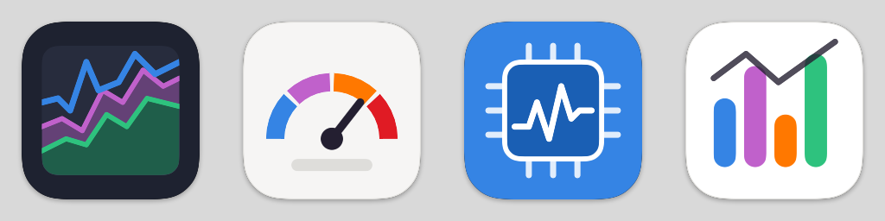

Deux niveaux d'animation, désactivables indépendamment :

- **Animations** (activé par défaut) : transitions de pages, surbrillance de la barre latérale, apparition du contenu. Coût quasi nul.
- **Animate live data** (désactivé par défaut) : défilement continu des graphes et chiffres qui roulent. Coûteux en CPU (voir ci-dessous).

Les deux respectent le réglage système *Accessibilité › Réduire les animations*.

## Sobriété

Mesures sur un MacBook Pro M5 Max, macOS 27, intervalle de 2 s, page Apps affichée (la plus coûteuse, avec ~1 150 processus) :

| Configuration | CPU (un cœur) | Mémoire |
| --- | --- | --- |
| Animations d'interface (défaut) | ~2,5 % | ~56 Mo |
| Sans animations | ~2,3 % | ~56 Mo |
| Données animées en direct | ~40 % | — |

Les points qui comptent :

- **Collecte à la demande** : la liste des processus, IOReport (puissance/fréquences) et les capteurs de température ne tournent que si la page affichée en a besoin.
- Un seul appel `proc_pidinfo(PROC_PIDTASKALLINFO)` par processus ; caches pour les chemins, les « processus responsables » et les noms d'utilisateur.
- La liste des applications n'est relue qu'au lancement ou à la fermeture d'une app (chaque propriété de `NSRunningApplication` peut déclencher un appel IPC à LaunchServices).
- Requêtes Wi-Fi et volumes mis en cache (respectivement 10 s et 15 s).
- Pas de `MTLDevice` : en créer un réserve plus de 100 Mo de mémoire GPU.
- Graphes dessinés avec des `Shape` (aucune vue par point), historique limité à 60 échantillons.

## Installation

Téléchargez `iRessources-X.Y.Z.dmg` depuis la [dernière release](https://github.com/blegal/iRessources/releases/latest) et glissez l'app dans Applications. Elle nécessite macOS 15 ou plus récent.

Ou avec Homebrew : `brew install --cask blegal/tap/iressources`

L'app n'est pas notarisée : au premier lancement, clic droit sur l'app › Ouvrir, ou `xattr -dr com.apple.quarantine /Applications/iRessources.app`.

## Compilation

Nécessite Xcode 16 ou plus récent et macOS 15+.

```sh
scripts/build-app.sh          # produit build/iRessources.app (signature ad hoc)
scripts/make-dmg.sh           # l'empaquette dans build/iRessources-<version>.dmg
open build/iRessources.app
```

Pour le développement : `swift run`. Pour voir ce qu'exposent les collecteurs sur une machine donnée, sans interface :

```sh
.build/debug/iRessources --dump
```

## Limites connues

- Sans privilèges root, macOS refuse les statistiques détaillées (CPU, E/S) des processus d'autres utilisateurs : elles apparaissent en « — ».
- Sur certaines puces, la consommation CPU et ANE n'est pas transmise aux processus non privilégiés ; l'app l'indique au lieu d'afficher 0 W.
- Les fréquences sont déduites des tables DVFS du gestionnaire d'alimentation, dont la disposition change selon la génération de SoC ; elles peuvent être approximatives.
- IOReport, les capteurs HID et `responsibility_get_pid_responsible_for_pid` sont des interfaces système non documentées (les mêmes que `powermetrics` ou le Moniteur d'activité) : l'app ne peut pas être publiée sur le Mac App Store.

## Licence

GPL-3.0-or-later, comme Resources. Voir [LICENSE](LICENSE).

Resources est © nokyan et ses contributeurs, distribué sous GPL-3.0-or-later.

## Développement

iRessources a été développé avec l'aide de [Claude Code](https://claude.com/claude-code), l'assistant de programmation d'Anthropic : écriture du code Swift, exploration des interfaces système de macOS, mesures de performance et mise au point de l'interface.
