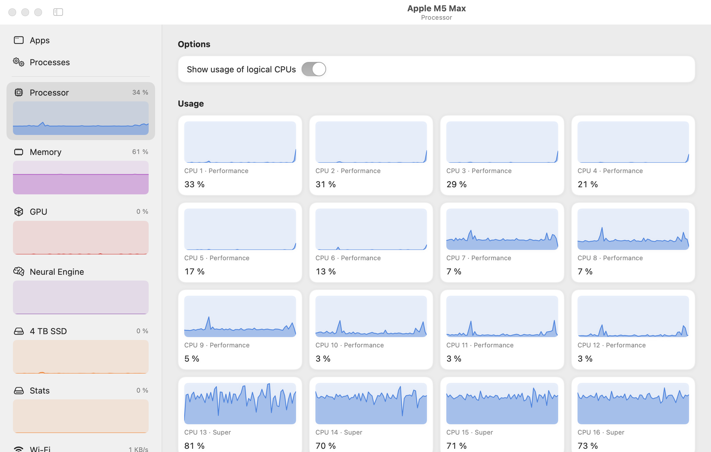
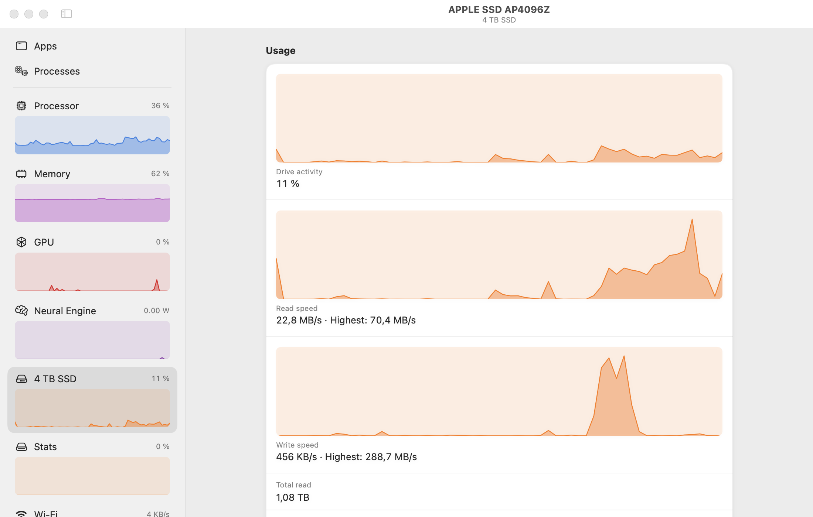
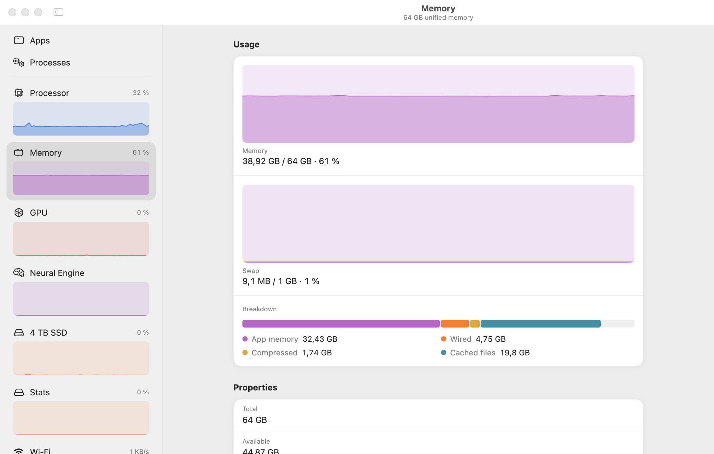
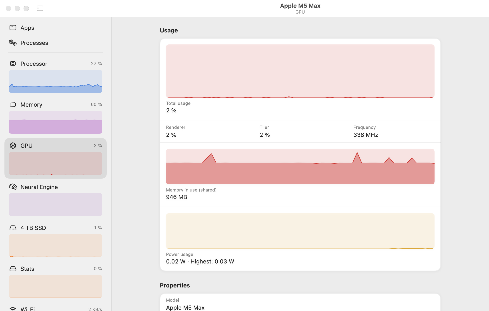
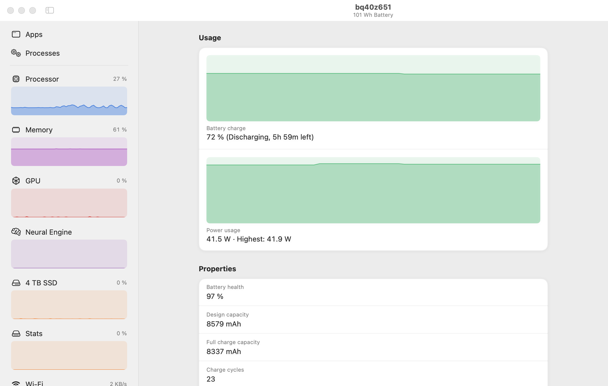
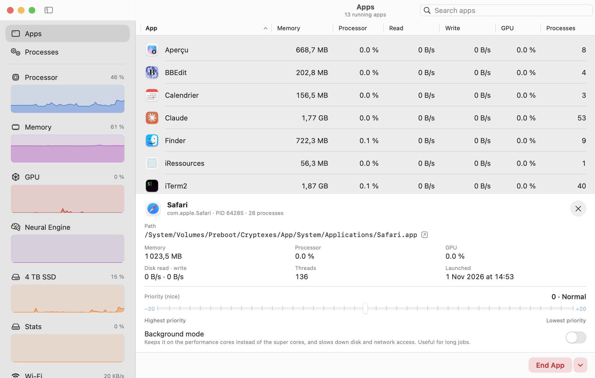
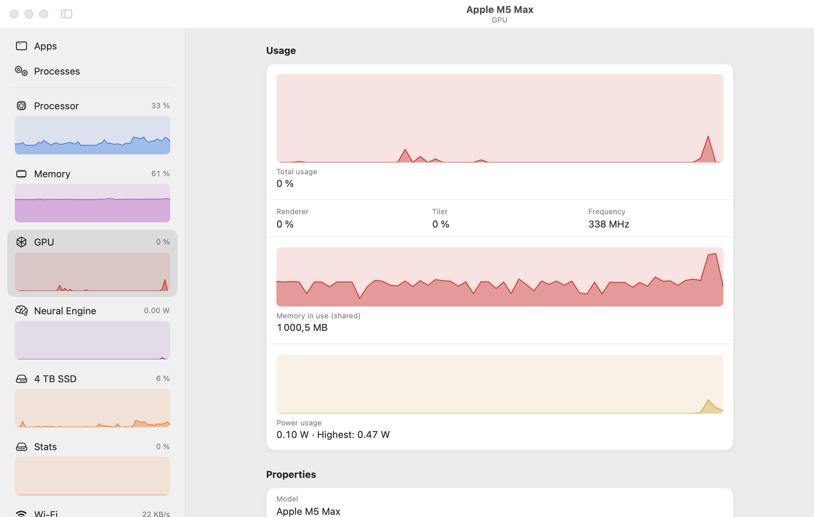
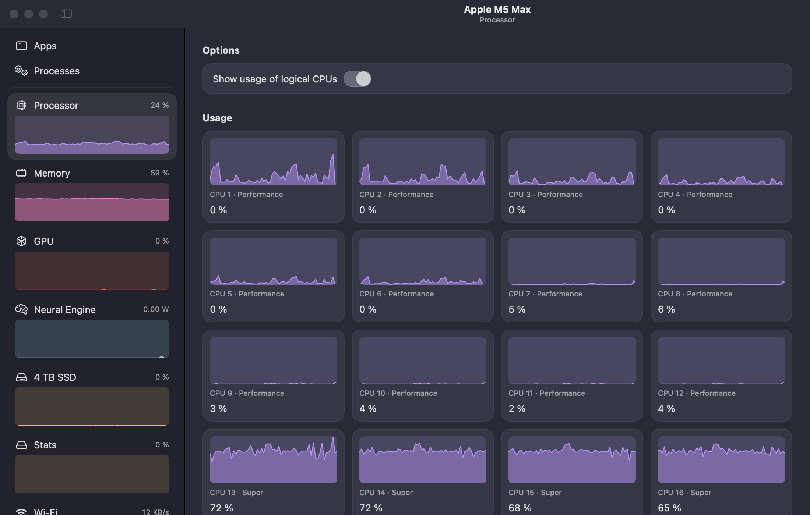
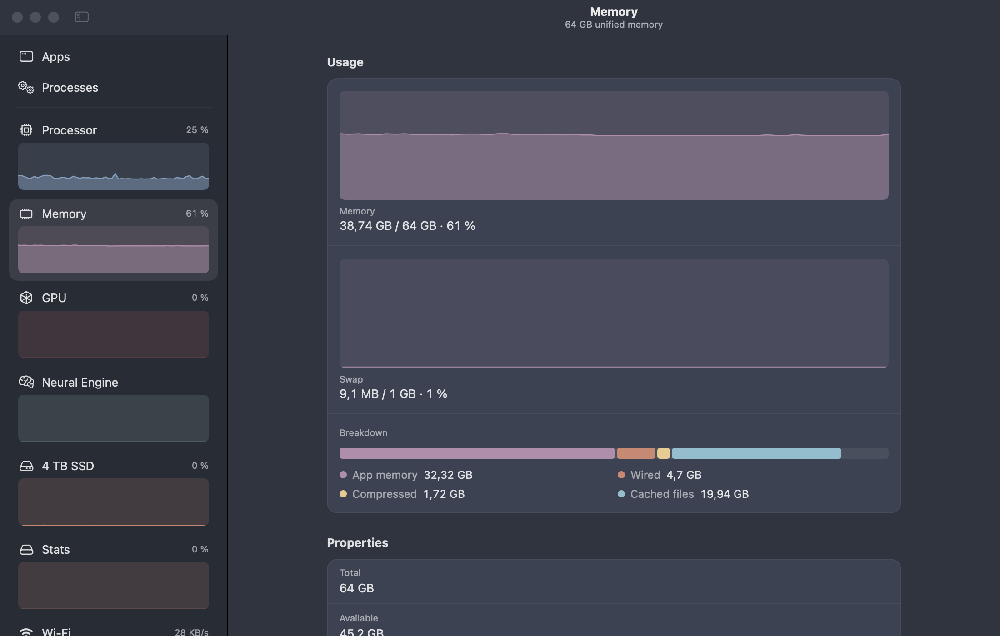

# iRessources

**English** · [Français](README.fr.md)

A native macOS port of [Resources](https://github.com/nokyan/resources), the GNOME system monitor, written in Swift / SwiftUI on top of Darwin's own APIs (Mach, IOKit, IOReport, libproc, SystemConfiguration, CoreWLAN).

<picture>
  <source media="(prefers-color-scheme: dark)" srcset="docs/screenshots/cpu-dark.png">
  
</picture>

The interface follows Resources closely: a sidebar with a live graph for every device, "Usage" / "Properties" pages laid out as boxed lists, and Apps and Processes tables with an action bar at the bottom.

| | |
| --- | --- |
| <picture><source media="(prefers-color-scheme: dark)" srcset="docs/screenshots/drive-dark.png"></picture> | <picture><source media="(prefers-color-scheme: dark)" srcset="docs/screenshots/memory-dark.png"></picture> |
| <picture><source media="(prefers-color-scheme: dark)" srcset="docs/screenshots/gpu-dark.png"></picture> | <picture><source media="(prefers-color-scheme: dark)" srcset="docs/screenshots/battery-dark.png"></picture> |

Screenshots follow the light or dark theme of your GitHub account.

## Acknowledgements

iRessources would not exist without **[Resources](https://github.com/nokyan/resources)**, the excellent GNOME system monitor created by **[nokyan](https://github.com/nokyan)**. The design, the page layout and many of the ideas come from there. Many thanks to its author, who very kindly agreed to let this port build on their work.

If you are on Linux, Resources is what you want: [on Flathub](https://flathub.org/apps/net.nokyan.Resources) or [on GitHub](https://github.com/nokyan/resources).

## From a GNOME app to a macOS app

iRessources is a rewrite, not a recompile: Resources is written in Rust with GTK 4 / libadwaita and reads `/proc`, `/sys` and Linux drivers, none of which exist on macOS. Every collector was rewritten on Darwin interfaces, and the interface rebuilt in SwiftUI.

What was **carried over**:

- Data sources: `/proc` → Mach and `libproc`; hwmon → HID sensors; RAPL, sysfs and NVML → IOReport and `IOAccelerator`; `/sys/block` → `IOBlockStorageDriver`; `/sys/class/net` → `SystemConfiguration` and CoreWLAN; `/sys/class/power_supply` → `AppleSmartBattery`.
- Apps: where Resources relies on cgroups and `.desktop` files, iRessources groups processes by their "responsible process" (as Activity Monitor does), which also ties XPC helpers to their app.
- Apple silicon specifics: core types (Super / Performance / Efficiency), per-cluster frequency, Neural Engine, unified memory.

What was **added or adapted**:

- A details drawer under the Apps list, with a priority (*nice*) slider and a **background mode** that keeps the app on the most power-efficient cores and throttles its I/O.
- Themes (including *Adwaita*, with Resources' colours), animations that can be turned off, macOS keyboard shortcuts.
- Close attention to frugality: data is collected on demand for the page on screen, and less often while the window is hidden (see [Frugality](#frugality)).

## Take control of your apps

Select an app to open a drawer under the list: where it lives on disk, what it uses right now, a **priority (*nice*) slider** applied to all its processes, and a **background mode** that keeps it on the most power-efficient cores and throttles its disk and network access. Handy for a long build or an export you don't want slowing everything else down.

<picture><source media="(prefers-color-scheme: dark)" srcset="docs/screenshots/apps-dark.png"></picture>

## Features

| Page | Contents |
| --- | --- |
| **Apps** | Open applications with all their processes (XPC helpers included, through the "responsible process" as in Activity Monitor). Memory, processor, disk read/write, GPU. Quit, force quit, hide. |
| **Processes** | Every process: PID, user, memory (physical footprint), processor, threads, disk I/O, per-process GPU. End, kill, suspend, resume; details panel (command line, parent, CPU time…). |
| **Processor** | Total and per logical core usage, core type (Super/Performance/Efficiency), frequency and activity per cluster, power (when exposed), cache, load, SoC temperature, thermal state. |
| **Memory** | Used / total, swap, breakdown (apps, wired, compressed, cache), memory pressure. |
| **GPU** | Usage (renderer/tiler), memory, frequency and power (Apple silicon), core count. |
| **Neural Engine** | ANE power draw (macOS does not publish a utilisation percentage). |
| **Drives** | Activity, read/write throughput, mounted volumes, interface, NAND temperature. |
| **Network** | Received/sent throughput, addresses, Wi-Fi (signal, channel, standard, link rate). |
| **Battery** | Charge, power, health, cycles, capacities, voltage, temperature, power adapter. |

While the window is hidden, the app refreshes at most every 5 s and turns off the expensive collectors.

## Themes and animations

*Settings › Appearance* offers the **Adwaita** (Resources' colours), **macOS**, **Pastel**, **Nord**, **Dracula**, **Solarized** and **Graphite** themes, plus light, dark or automatic mode.

| Adwaita | Dracula | Nord |
| --- | --- | --- |
|  |  |  |

Two levels of animation, each of which can be turned off:

- **Animations** (on by default): page transitions, sidebar highlight, content appearing. Practically free.
- **Animate live data** (off by default): continuously scrolling graphs and rolling numbers. Expensive in CPU (see below).

Both respect the system setting *Accessibility › Reduce motion*.

## Frugality

Measured on a MacBook Pro M5 Max, macOS 27, 2 s interval, Apps page on screen (the most expensive one, with ~1,150 processes):

| Configuration | CPU (one core) | Memory |
| --- | --- | --- |
| Interface animations (default) | ~2.5 % | ~56 MB |
| No animations | ~2.3 % | ~56 MB |
| Animated live data | ~40 % | — |

What matters:

- **On-demand collection**: the process list, IOReport (power/frequencies) and temperature sensors only run when the page on screen needs them.
- A single `proc_pidinfo(PROC_PIDTASKALLINFO)` call per process; caches for paths, "responsible processes" and user names.
- The application list is only re-read when an app launches or quits (every `NSRunningApplication` property can trigger an IPC call to LaunchServices).
- Wi-Fi and volume queries are cached (10 s and 15 s respectively).
- No `MTLDevice`: creating one reserves more than 100 MB of GPU memory.
- Graphs are drawn with `Shape`s (no view per point), with history limited to 60 samples.

## Building

Requires Xcode 16 or later and macOS 15+.

```sh
scripts/build-app.sh          # builds build/iRessources.app (ad hoc signature)
open build/iRessources.app
```

For development: `swift run`. To see what the collectors expose on a given machine, without the interface:

```sh
.build/debug/iRessources --dump
```

## Known limitations

- Without root privileges, macOS refuses detailed statistics (CPU, I/O) for other users' processes: they show as "—".
- On some chips, CPU and ANE power is not reported to unprivileged processes; the app says so instead of showing 0 W.
- Frequencies are derived from the power manager's DVFS tables, whose layout changes between SoC generations; they may be approximate.
- IOReport, the HID sensors and `responsibility_get_pid_responsible_for_pid` are undocumented system interfaces (the same ones `powermetrics` and Activity Monitor use): the app cannot be published on the Mac App Store.

## Licence

GPL-3.0-or-later, like Resources. See [LICENSE](LICENSE).

Resources is © nokyan and contributors, distributed under GPL-3.0-or-later.

## Development

iRessources was developed with the help of [Claude Code](https://claude.com/claude-code), Anthropic's coding assistant: writing the Swift code, exploring macOS system interfaces, measuring performance and polishing the interface.
